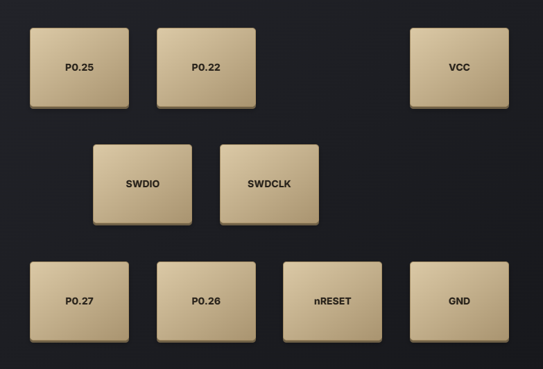

# OpenTag firmware for nRF52811

Firmware for OpenTag electronic shelf labels based on the Nordic nRF52811, primarily for Newton M3 devices. The tag communicates with the Gateway over the OpenEPaperLink radio protocol, the Gateway prepares the screen content and the tag receives and displays it.

This repository contains the tag firmware and its bootloader. **It does not contain the Gateway firmware or web administration.** The Gateway firmware is in the [OpenTag-Gateway](https://github.com/ondrahladik/OpenTag-Gateway) repository.

## Features

- Searches for a Gateway on startup and when the connection is lost. Depending on the configuration, it can use a fixed channel or scan channels and switch to a more suitable one.
- Communicates with the Gateway at regular check-ins. It reports the tag status, including battery, temperature, radio connection, hardware, and wake-up reason.
- Receives images prepared by the Gateway in uncompressed 1bpp or 2bpp formats and compressed Zlib format. A stored image can be rendered again after wake-up.
- Receives firmware updates over the air (OTA) from the Gateway, the downloaded update is passed to the bootloader and the tag restarts.
- Displays startup and status screens, for example when searching for or losing the Gateway and when the battery is low. The Gateway can also provide custom status images.
- Detects tag and display hardware properties at startup, such as resolution, display type, and available features.
- Reduces power consumption by putting the radio and display to sleep and adjusts check intervals based on communication results.
- After startup or restart, schedules another quick check-in about 30 seconds after the first check-in so it can receive an image prepared by the Gateway. Delivery still depends on Gateway availability, radio connectivity, and an image being ready.

### Buttons

On boards with two buttons, button 1 performs a check-in followed by a quick check of the Gateway, button 2 restarts the tag. For example, the Newton M3 Peghook has one button, which uses the button 1 function.

### Scope and differences

- The tag firmware does not create screen content itself and does not include a slideshow, images are prepared and assigned by the Gateway.
- Button functions are fixed, user-assigned screens for buttons are not supported.
- Old stored slideshow modes are converted to normal mode when settings are loaded.
- Status screens use the label “GW” and the startup screen uses the “OpenTag” brand.
- The eight-byte tag identifier remains part of internal communication. For readability, its shorter six-byte form is shown on screen.

## Repository contents

- `tag_fw/` – tag application, HAL, PlatformIO configuration, and helper scripts for creating firmware images.
- `tag_bootloader/` – bootloader project for the nRF52811.
- `shared/` and `common/` – shared protocol definitions and common implementation components.
- `flash_tag.py` – builds the application and flashes it to the tag over ST-Link/SWD.
- `LICENSE.md` – license for this repository.

## Building the firmware

The script requires Windows, Python 3.10 or later, and PlatformIO Core/CLI. PlatformIO can be run from `PATH` or from the usual PlatformIO IDE location. The project uses the `tag_fw/platformio.ini` configuration, PlatformIO builds the `Newton_M3_Universal` environment from it and creates the firmware images.

Run this from the repository root:

```powershell
py flash_tag.py --build
```

This builds the firmware without flashing the tag. The script first cleans the previous build, then runs PlatformIO and verifies that a new full HEX image was created.

After a successful build, these files are created in `tag_fw/`:

- `Newton_M3_Universal-full-flash.hex` – Intel HEX image for flashing over ST-Link, contains both the application and bootloader and is used by `flash_tag.py`.
- `Newton_M3_Universal-full-flash.bin` – binary version of the full image.
- `Newton_M3_Universal-ota.bin` – application image intended for OTA through the Gateway, **do not use it for direct flashing over ST-Link**.

The HEX file is generated during the build and may not be stored in the repository. After a clean clone, run the build first, even if you intend to use `--flash` later.

## Flashing the tag with ST-Link

### Requirements

- An nRF52811 tag with a stable power supply.
- An ST-Link that supports SWD.
- OpenOCD for Windows, with a directory structure containing `bin/openocd.exe` and `openocd/scripts/`.
- For normal programming, connect `SWDIO`, `SWCLK`, `GND`, and `3.3 V`. The tag can be powered from the ST-Link 3.3 V output if the adapter supports it, or from a separate stable 3.3 V supply.
- For connect-under-reset mode, also connect `NRST`.

### Pinout



The script looks for OpenOCD in `openocd/` next to `flash_tag.py`, then in `openocd/` one level above. If it is elsewhere, provide the path using `--openocd-dir`.

### Build and flash

Run this from the repository root:

```powershell
py flash_tag.py
```

The script builds the firmware and asks `Upload firmware now? [Y/n]` before flashing. Confirm with Enter or `y` to start OpenOCD, write the full HEX image, verify the write, and reset the tag. Answer `n` to finish the build without flashing.

To run automatically without the confirmation prompt:

```powershell
py flash_tag.py --yes
```

### Modes and options

```text
py flash_tag.py --build
py flash_tag.py --flash
py flash_tag.py --env Newton_M3_Universal
py flash_tag.py --platformio "C:\path\to\platformio.exe"
py flash_tag.py --openocd-dir "C:\path\to\openocd"
py flash_tag.py --adapter-speed 100
py flash_tag.py --connect-under-reset
```

- `--build` builds the firmware and exits without flashing.
- `--flash` flashes the existing `Newton_M3_Universal-full-flash.hex` without rebuilding.
- `--yes` skips the confirmation and builds and flashes the firmware.
- `--env` selects the PlatformIO environment, the default is `Newton_M3_Universal`.
- `--platformio` specifies the PlatformIO executable if it is not found automatically.
- `--openocd-dir` specifies the OpenOCD root directory.
- `--adapter-speed` sets the SWD speed in kHz (100–4000, default 100).
- `--connect-under-reset` uses connect-under-reset mode, this requires `NRST` to be connected.
- `--project` specifies another project directory containing `platformio.ini`.

Direct flashing writes the internal flash regions included in the full HEX image, including the bootloader. Use the correct image for this hardware. Do not disconnect power or SWD during programming or verification.

## Troubleshooting

- **PlatformIO was not found:** install PlatformIO Core or use `--platformio` with the path to its executable.
- **OpenOCD was not found:** check the OpenOCD directory and provide it using `--openocd-dir`.
- **OpenOCD cannot connect (`init mode failed`):** check the tag power, common ground, and `SWDIO`/`SWCLK`/`3.3 V` connections. Lower the speed with `--adapter-speed 100`, if `NRST` is connected, `--connect-under-reset` may help.
- **Programming fails after writing has started:** the result may be partial. Check the power stability and wiring, then run programming again.
- **`--flash` cannot find the HEX file:** run `py flash_tag.py --build` first.

## Credits and license

The project is based on [OpenEPaperLink – Tag_FW_nRF52811](https://github.com/OpenEPaperLink/Tag_FW_nRF52811). Thanks to the authors and contributors of the original project and the wider OpenEPaperLink ecosystem.

The terms of use and attribution are specified in [LICENSE.md](LICENSE.md) (CC BY-NC-SA 4.0).
